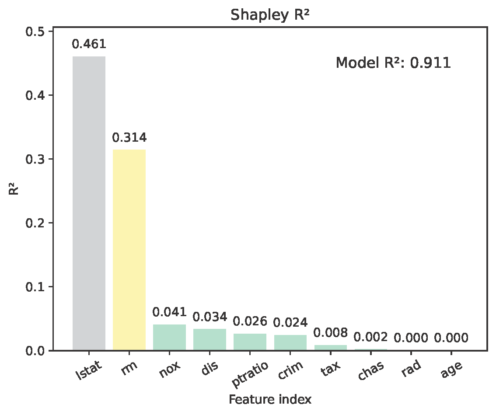

Plotting guide
==============

Use global plots to summarize feature contributions and heatmaps to inspect
the observation-level decomposition. The existing Boston housing example
illustrates a labeled global bar chart:

   Output from the existing Boston housing example in the
   `project README <https://github.com/catstats/Q-SHAP#quick-start-with-xgboost>`_.
   The synthetic examples below use their own smaller dataset.

:download:`Download the complete plotting script <scripts/plotting.py>`.

Prepare contributions and feature labels
----------------------------------------

.. literalinclude:: scripts/plotting.py
   :language: python
   :start-after: # example:setup
   :end-before: # end:setup

Label and save a global bar chart
---------------------------------

:py:meth:`qshap.vis.rsq` ranks values and applies the same ordering to labels.
``max_feature`` limits the number displayed; ``save_name`` is a file prefix
to which ``.pdf`` is appended.

.. literalinclude:: scripts/plotting.py
   :language: python
   :start-after: # example:bar
   :end-before: # end:bar

The default ``cutoff=0`` shows nonnegative contributions. The model-R-squared
annotation uses the sum of the full input vector, before feature selection.
Inspect signed values in the numeric table or the
:doc:`local-contribution heatmap <local_contributions>`.

Use horizontal bars
-------------------

Horizontal bars provide more room for longer feature labels.

.. literalinclude:: scripts/plotting.py
   :language: python
   :start-after: # example:horizontal
   :end-before: # end:horizontal

Plot cumulative contributions
-----------------------------

:py:meth:`qshap.vis.cumu` adds ranked contributions cumulatively. The
horizontal reference line is the sum of the full input vector.

.. literalinclude:: scripts/plotting.py
   :language: python
   :start-after: # example:cumulative
   :end-before: # end:cumulative

Inspect the ranked contribution curve
-------------------------------------

:py:meth:`qshap.vis.elbow` returns the displayed features' zero-based indices
in ranked order, allowing you to recover their names.

.. literalinclude:: scripts/plotting.py
   :language: python
   :start-after: # example:elbow
   :end-before: # end:elbow

Use generalized correlations when values are nonnegative
--------------------------------------------------------

:py:meth:`qshap.gazer.gcorr` takes elementwise square roots, while
:py:meth:`qshap.vis.gcorr` plots that transformation. A negative R-squared
contribution has no real-valued square root; retain its signed value when
reporting the decomposition.

.. literalinclude:: scripts/plotting.py
   :language: python
   :start-after: # example:gcorr
   :end-before: # end:gcorr

Explore raw losses in a notebook
--------------------------------

With the ``result`` created above, :py:meth:`qshap.vis.loss` provides an
observation selector in Jupyter:

.. code-block:: python

   vis.loss(result.loss)

This helper uses the bar chart's default nonnegative cutoff. To inspect
signed loss contributions, use ``vis.heatmap(result, quantity="loss")`` as in
:doc:`local_contributions`.
