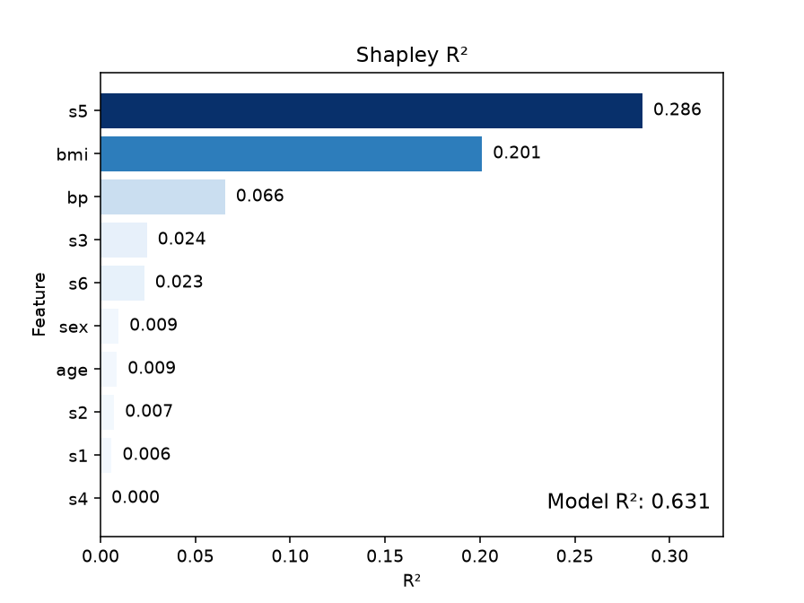

Q-SHAP documentation
====================

Q-SHAP decomposes a fitted tree regression model's R-squared into feature
contributions.

.. admonition:: Model examples
   :class: note

   :ref:`XGBoost <xgboost-example>` · :ref:`LightGBM <lightgbm-example>` ·
   :ref:`CatBoost <catboost-example>`

Start with XGBoost
------------------

Fit an XGBoost regressor on the diabetes dataset and plot how much each
feature contributes to the fitted model's R-squared. See the
:doc:`installation guide <installation>` to install the XGBoost extra.

.. code-block:: python

   from qshap import gazer, vis
   from sklearn.datasets import load_diabetes
   from xgboost import XGBRegressor

   X, y = load_diabetes(return_X_y=True, as_frame=True)
   model = XGBRegressor(n_estimators=20, max_depth=2, n_jobs=1, random_state=42)
   model.fit(X, y)
   contributions = gazer(model).rsq(X, y, progress_bar=False)
   vis.rsq(contributions, label=X.columns, horizontal=True, xtitle="Feature")

         contributions come from s5 and bmi. The fitted model's R-squared is 0.631.

   Output from the XGBoost example above.

.. toctree::
   :maxdepth: 1
   :caption: Getting started

   installation
   quickstart

.. toctree::
   :maxdepth: 2
   :caption: Examples

   Example gallery <examples/index>

.. toctree::
   :maxdepth: 2
   :caption: Reference

   api
